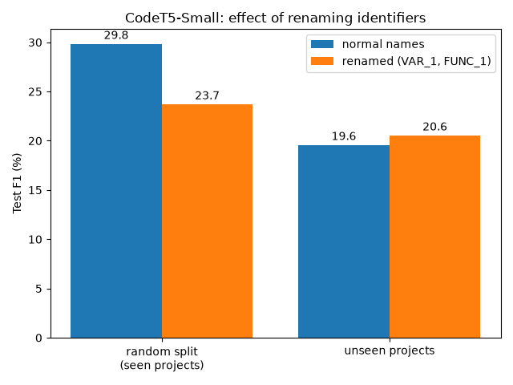

# Vulnerability Detection on DiverseVul

Course project for **Advanced Software Engineering**.

We build on the paper
[DiverseVul: A New Vulnerable Source Code Dataset for Deep Learning Based Vulnerability Detection](https://arxiv.org/abs/2304.00409)
(Chen et al., RAID 2023).

## The problem in one paragraph

Can a model read a C/C++ function and say "this has a security bug"? The paper shows
that a model (CodeT5) gets about **45% F1** when tested on code similar to its
training data, but only about **9% F1** on **projects it has never seen**.
The authors guess the model memorizes project-specific habits (like variable names),
but they don't test this. The dataset also has known problems, such as duplicate functions
that only differ in whitespace.

## What we do

| Step | What | Runs on |
|------|------|---------|
| 1 | Explore the dataset (counts, projects, bug types) | Laptop |
| 2 | **Improvement A:** clean the data - remove whitespace/comment duplicates | Laptop |
| 3 | Reproduce the paper's baseline (fine-tune CodeT5-Small) | Google Colab (GPU) |
| 4 | **Improvement B:** rename identifiers (`buf_len` -> `VAR_1`) and check if the model does better on unseen projects | Google Colab (GPU) |
| 5 | Write the report and results | - |

## Folder structure

```
data/        dataset files (not in git, too big)
src/         Python scripts for steps 1, 2, 4, 5
notebooks/   training notebook (runs on Colab)
notebooks/runs/  the 4 executed training notebooks, with all outputs
results/     tables and charts we produce
```

## How to run

Run all commands from the project folder.

```bash
pip install -r requirements.txt
python src/download_data.py   # downloads the dataset (~740 MB) into data/
python src/explore.py         # Step 1: prints dataset statistics, saves charts to results/
python src/clean_dedup.py     # Step 2: removes whitespace/comment duplicates -> data/diversevul_clean.json
python src/splits.py          # prints the size of the random and unseen-project splits
python src/rename_ids.py      # Step 4: shows identifier renaming on an example function
```

**Steps 3 and 4 (training)** run on Google Colab: open `notebooks/train_codet5.ipynb` in Colab,
choose a T4 GPU, and run all cells. It clones this repo, downloads and cleans the data,
trains CodeT5-Small and prints the test results. Set `SPLIT` (`random` / `unseen`) and
`RENAME_IDS` (`False` / `True`) in the settings cell for the 4 runs.
Training settings: max 256 tokens per function, 3 epochs, learning rate 1e-4, batch size 16,
1 vulnerable : 3 safe functions in training (validation and test keep the real balance).

```bash
python src/plot_results.py    # Step 5: results table + chart (results/f1_comparison.png)
```

## Results

### Step 2: data cleaning
After removing comments and whitespace, we found **4,397 groups of duplicate functions**.
**900 groups had both labels** (same code, labelled vulnerable *and* safe), so
**901 "vulnerable" labels (~4.8%) were wrong**. That matches the paper's manual
estimate of ~4% whitespace-only label errors. We removed 5,440 functions in total
(details in `results/step2_dedup_summary.txt`).

### Steps 3 and 4: CodeT5-Small (test set, %)

| Run | Test data | Identifiers | Precision | Recall | **F1** | FPR |
|-----|-----------|-------------|-----------|--------|--------|-----|
| 1 | random split | normal | 24.17 | 38.99 | **29.84** | 7.41 |
| 2 | unseen projects | normal | 18.94 | 20.26 | **19.58** | 5.56 |
| 3 | random split | renamed | 20.39 | 28.33 | **23.71** | 6.70 |
| 4 | unseen projects | renamed | 15.19 | 31.74 | **20.55** | 11.36 |



**What we found**
1. **The generalization problem is real.** F1 drops from 29.8 to 19.6 on projects
   the model never saw (the paper saw 49 -> 9).
2. **Renaming identifiers does not fix it.** On unseen projects F1 only moves from
   19.6 to 20.6. That's too small to call an improvement from a single run.
   Renaming finds more real bugs (recall 20.3 -> 31.7) but raises about twice as many
   false alarms (FPR 5.6 -> 11.4).
3. **Names carry useful information.** On the random split, renaming *lowers* F1 from
   29.8 to 23.7. Names like `len`, `buf`, `size` tell the model what the code does.
   So the paper's guess (that the model fails on new projects because it memorizes
   project-specific names) is **not supported** in our setup.

**Why our F1 is lower than the paper's (~45%)**: we cut functions at 256 tokens
(vulnerable functions are long, so the buggy line is often cut off), train on fewer
functions for only 3 epochs (free Colab GPU), and use the cleaned data, which has
fewer near-duplicates shared between training and test. Each run was done once
(one random seed), so small differences (~1 point) may be noise.

## Dataset

DiverseVul: https://github.com/wagner-group/diversevul
